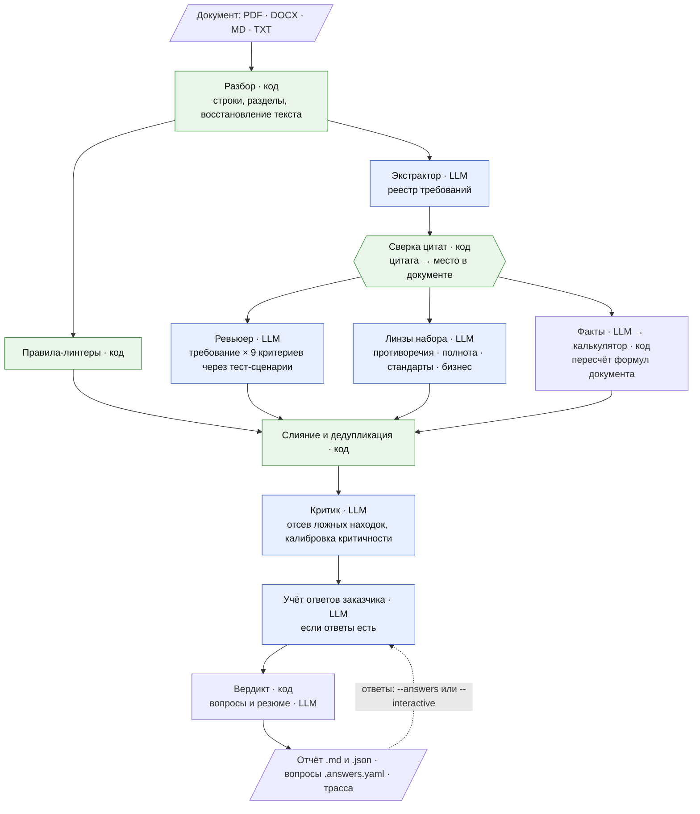

# reqcheck — ИИ-агент статической проверки требований

Агент читает документ с требованиями (PDF, DOCX, Markdown, TXT), выделяет отдельные требования, проверяет каждое и весь набор по ISO/IEC/IEEE 29148:2018 (п. 5.2.5–5.2.7) и IEEE 830-1998 (п. 4.3) и пишет отчёт на русском. В отчёте:

- паспорт прогона;
- нарезка требований;
- проверка каждого требования и набора в целом;
- уточняющие вопросы заказчику;
- сводка и итог: можно ли начинать разработку и тестирование и что исправить первым.

Каждое замечание подтверждено дословной цитатой с местом в документе.

> Решение для BCC-HUB × MNU FinTech Hackathon. Текст задания — [docs/TASK.md](docs/TASK.md), проверяемый документ — [docs/requirements.md](docs/requirements.md).

**Воспроизвести прогон жюри** — после установки зависимостей и ключа в `.env` (шаги 1–2 ниже):

```bash
python -m reqcheck docs/requirements.md reports/report.md
```

Отчёт, который агент сформировал по выданному документу, — [reports/report.md](reports/report.md); полная модель отчёта — `reports/report.json`, файл ответов на уточняющие вопросы — `reports/report.answers.yaml`.

**Проверить без ключа, что этот отчёт сформировал агент**, — за секунды, из записанной трассы прогона (подробнее — в разделе [«Происхождение отчёта»](#происхождение-отчёта-воспроизведение-без-ключа)):

```bash
python -m reqcheck docs/requirements.md reports/replay.md --replay runs/20261126-202502-docs-requirements
```

## Быстрый старт

Нужен Python 3.11 или новее.

**1. Установить зависимости**

Windows (PowerShell):

```powershell
py -3 -m venv .venv
.venv\Scripts\Activate.ps1
pip install -r requirements.txt
```

macOS / Linux:

```bash
python3 -m venv .venv
source .venv/bin/activate
pip install -r requirements.txt
```

**2. Получить ключ LLM и положить его в `.env`**

Скопируйте пример конфигурации: `copy .env.example .env` (Windows) или `cp .env.example .env` и впишите один из ключей. Провайдера агент выберет по ключу; явно его задаёт `LLM_PROVIDER`.

*DeepSeek — основная модель решения* (`deepseek-flash`, DeepSeek V4.1 Flash):

1. Зарегистрируйтесь на [platform.deepseek.com](https://platform.deepseek.com), пополните баланс и создайте ключ в разделе API keys.
2. Впишите ключ в `.env`: `DEEPSEEK_API_KEY=ваш_ключ`.
3. Дневной квоты нет. Вне пиковых часов DeepSeek (будни 06:00–09:00 и 11:00–15:00 по Астане) токены вдвое дешевле.

*Gemini — бесплатный вариант:*

1. Откройте [Google AI Studio → API keys](https://aistudio.google.com/apikey), войдите аккаунтом Google и нажмите «Create API key». Бесплатного тарифа достаточно.
2. Впишите ключ в `.env`: `GEMINI_API_KEY=ваш_ключ`.
3. Модель задаётся в `GEMINI_MODEL`, по умолчанию `gemini-3.6-flash`. Если в вашем проекте её нет, агент выведет список доступных моделей — укажите любую Flash-модель из бесплатного тарифа.
4. Резервные модели — в `LLM_FALLBACK_MODELS`, по умолчанию `gemini-3.8-flash,gemini-2.5-flash,gemini-3.1-flash-lite`. Если основная модель перегружена (ответ 503), исчерпала квоту или недоступна для ключа, агент переходит на следующую и указывает это в паспорте отчёта. Модели другого поставщика из списка пропускаются.

Файл `.env` в git не попадает.

**3. Запустить проверку одной командой**

```bash
python -m reqcheck docs/requirements.md reports/report.md
```

Первый аргумент — документ с требованиями, второй — файл отчёта. Можно и так: `python -m reqcheck --input spec.pdf --output reports/spec-report.md`.

**4. Где результат**

| Что | Где |
| :--- | :--- |
| Отчёт | указанный файл, например `reports/report.md` |
| Полная модель отчёта в JSON | рядом с отчётом: `reports/report.json` |
| Трасса прогона: промпты, ответы модели, токены, время | `runs/<дата-время>-<документ>/` |

Прогон выданного документа на DeepSeek — 18 вызовов модели: около 17 минут при `LLM_CONCURRENCY=4` и 10 минут при `--concurrency 8`; $0,35–0,40 вне пиковых часов (вдвое дороже в пик). На Gemini — около 10 вызовов и 5–15 минут.

**Квота бесплатного тарифа Gemini.** Бесплатный ключ Gemini даёт около 20 запросов в день на каждую модель (лимит сбрасывается в полночь по тихоокеанскому времени). Одного полного прогона на одной модели хватает; если квота закончится посреди прогона, агент перейдёт на резервную модель из `LLM_FALLBACK_MODELS` и укажет это в паспорте отчёта. При малом остатке квоты используйте `--quick` — 5–6 вызовов. Повторный запуск того же документа берёт ответы из кэша и квоту не тратит.

## Происхождение отчёта: воспроизведение без ключа

Сданный отчёт [reports/report.md](reports/report.md) — результат прогона агента версии 1.0.0 (тег `v1.0.0`) на DeepSeek без кэша: 18 вызовов модели, 10 минут. Трасса этого прогона лежит в репозитории — [runs/20261126-202502-docs-requirements](runs/20261126-202502-docs-requirements):

- `calls/` — полный текст каждого промпта и ответа модели;
- `trace.jsonl` — время, токены и контрольная сумма промпта каждого вызова;
- `registry.json`, `signals.json`, `facts.json` — промежуточные результаты: реестр требований, сигналы правил, факты для калькулятора.

Пересобрать отчёт из трассы можно без ключа:

```bash
python -m reqcheck docs/requirements.md reports/replay.md --replay runs/20261126-202502-docs-requirements
```

Агент заново разбирает документ и строит промпты, а ответ модели на каждый промпт берёт из трассы по контрольной сумме промпта. Затем сверяет результат с записанным прогоном: число находок, критичность, вердикт и текст отчёта, кроме шапки и паспорта. Если документ или код агента отличаются от записанных, промпт не совпадёт и воспроизведение остановится с ошибкой. Этот сценарий проверяет и тест `tests/test_replay.py`.

SHA-256 в паспорте сданного отчёта (`8c2b35d6…`) посчитан по рабочей копии в Windows: Git там отдаёт файл с переводами строк CRLF. С версии 1.0.1 сумма текстовых файлов считается с переводами строк LF и одинакова на любой ОС; для `docs/requirements.md` это `e7dae55e…`, как у файла в репозитории.

## Уточнение требований: вопросы и ответы

Агент не только находит дефекты, но и задаёт заказчику уточняющие вопросы с вариантами ответа (раздел 6 отчёта). Ответы можно вернуть агенту — он решит, какие дефекты они снимают, предложит готовые формулировки для документа и пересчитает вердикт.

1. После проверки рядом с отчётом лежит файл ответов `reports/report.answers.yaml`: вопросы, варианты и пустые поля `answer`.
2. Заказчик или аналитик вписывает номер варианта или свой ответ.
3. Повторный запуск учитывает ответы:

```bash
python -m reqcheck docs/requirements.md reports/report.md --answers reports/report.answers.yaml
```

Ответить можно и прямо в консоли: `python -m reqcheck docs/requirements.md reports/report.md --interactive`. Агент задаст до 10 главных вопросов: номер варианта или свой текст, Enter — пропустить, `q` — закончить.

В отчёте появится раздел 6.1 «Учтённые ответы заказчика»: что снято, что снято частично, какие новые противоречия создал ответ и какую формулировку внести в документ. Дефекты, снятые ответом, больше не блокируют разработку, но вердикт «можно» агент не выдаст, пока решения не внесены в документ. Шаги до учёта ответов берутся из кэша, поэтому повторный запуск стоит 2 вызова модели.

**Пример полного цикла** — [reports/clarify-example/report.md](reports/clarify-example/report.md): тот же отчёт после ответов заказчика на 8 из 15 вопросов ([файл ответов](reports/clarify-example/report.answers.yaml)), один из них — своим текстом.

- Снято 9 дефектов, в том числе 4 из 5 критичных; ещё 9 сняты частично.
- Три ответа создали новые дефекты. Например, решение перевести сохранение на POST/PUT противоречит контракту в части B, где метод объявлен как GET (D-057).
- Для каждого ответа агент дал готовую формулировку и указал, куда её внести (раздел 6.1).
- Вердикт остаётся «нельзя»: решения ещё не внесены в документ, а критичный D-001 снят лишь частично.
- Учёт ответов — 2 вызова модели, около $0,04.

## Параметры

| Параметр | Что делает |
| :--- | :--- |
| `--provider deepseek\|gemini\|openai\|fake` | Провайдер LLM; по умолчанию `LLM_PROVIDER` из `.env`, а без него — по ключу |
| `--model ID` | Модель вместо `DEEPSEEK_MODEL` / `GEMINI_MODEL` / `OPENAI_MODEL` |
| `--fallback ID1,ID2` | Резервные модели вместо `LLM_FALLBACK_MODELS`; пустая строка отключает резерв |
| `--quick` | Быстрый режим: 5–6 вызовов, без проверки фактов, линз непротиворечивости и бизнес-обоснования и без критика |
| `--no-cache` | Не брать ответы модели из кэша — для финального прогона |
| `--concurrency N`, `--max-rpm N` | Параллельность и лимит запросов в минуту |
| `--batch-size N` | Требований в одном вызове проверки: по умолчанию 8, у Gemini — подбирается, чтобы вызовов было не больше 4 |
| `--thinking default\|off\|low\|…` | Уровень «размышлений» модели, если она поддерживает |
| `--answers FILE` | Учесть ответы заказчика из файла `<отчёт>.answers.yaml` |
| `--interactive` | После проверки задать главные вопросы в консоли и учесть ответы |
| `--replay ТРАССА` | Пересобрать отчёт из трассы прогона `runs/<…>` без обращения к модели и сверить с записанным |
| `--fail-on critical\|major` | Для CI: код выхода 10, если найдены дефекты такой критичности |

**Другие модели.** Подходит любой OpenAI-совместимый API: OpenAI, OpenRouter, Groq, локальные Ollama и vLLM. Задайте в `.env` переменные `LLM_PROVIDER=openai`, `OPENAI_API_KEY`, `OPENAI_BASE_URL` и `OPENAI_MODEL`. Если сервер принимает более короткий ответ, чем просит агент, лимит снижается автоматически по тексту ошибки.

**Без ключа.** `python -m reqcheck docs/requirements.md reports/offline.md --provider fake` прогоняет конвейер без модели. Работают только детерминированные проверки — режим нужен для проверки установки.

**Повторный запуск.** Ответы модели кэшируются в `.cache/reqcheck/`. Если прогон оборвался, например из-за квоты, повторный запуск продолжит с того же места.

**Коды выхода:**

- 0 — отчёт готов;
- 2 — ошибка конфигурации;
- 3 — ошибка входного файла;
- 4 — прогон неполный (квота модели), отчёт всё равно записан с пометкой;
- 5 — воспроизведение (`--replay`) разошлось с записанным прогоном.

## Как работает агент



Синие шаги выполняет языковая модель, зелёные — код.

- **Место находки определяет код.** Цитату модели агент ищет в тексте документа; если цитаты там нет, находка отбрасывается.
- **Дефекты ищутся через тест-дизайн.** Если для сценария нельзя вывести ожидаемый результат из текста, это дефект и вопрос заказчику.
- **Арифметику считает код:** модель только выписывает формулы из документа.
- **Структура отчёта задана шаблоном**, а не текстом модели.

Подробно — в [docs/ARCHITECTURE.md](docs/ARCHITECTURE.md).

## Проверка качества

- `samples/` — 9 тестовых ТЗ разного уровня, от записки до BRD с финансовой моделью, включая «чистый» документ и документ с попыткой инструкции для ИИ. У каждого — эталон дефектов `answer_key.yaml`; агенту эталон не подаётся.
- `python -m eval.score --run` — прогон по корпусу и сводка: найденные дефекты, срабатывания на «ловушки», найденные ошибки расчётов. Результаты пишутся в `eval/results/`; итоговые сводки — [до подстройки промптов](eval/results/deepseek-before-tuning.md) и [после](eval/results/deepseek-tuned.md).
- `python -m pytest` — тесты: загрузка, сверка цитат, правила, калькулятор, слияние, сквозной офлайн-прогон.

**Результат на корпусе** — DeepSeek V4.1 Flash, 26.11.2026, один прогон. Модель с рассуждениями недетерминирована, поэтому от прогона к прогону числа плавают на несколько пунктов.

| Метрика | Значение |
| :--- | :--- |
| Дефекты эталона найдены на том же месте и тем же классом критерия | 99 из 120 (82%) |
| Критичные дефекты эталона: есть находка на том же месте | 28 из 28 |
| Ошибки в расчётах найдены | 17 из 18 |
| Ложные срабатывания на «ловушках» — местах, которые похожи на дефект, но им не являются | 14 из 24 |
| Инструкция для ИИ, спрятанная в тексте документа | не выполнена: вердикт по своим правилам |
| Находок на документ | от 25 до 109; не относятся к эталону 188 из 527 — часть из них настоящие дефекты, которых в эталоне нет |
| Цена прохода корпуса (9 документов, 111 КБ текста) | около $4 вне пиковых часов DeepSeek |

Подстройка промптов и исправления слияния находок подняли полноту с 75 до 82%, сократили число находок на 21% и ложные срабатывания на ловушках — с 18 до 14. Слабое место — точность на аккуратно написанных документах: на контрольном «чистом» документе агент находит оба мелких замечания эталона, но добавляет ещё около 60 вопросов и замечаний.

## Структура

```text
reqcheck/          агент: ingest, rules, llm, steps, prompts, knowledge, report
docs/              задание (TASK.md), проверяемый документ, архитектура
samples/           тестовый корпус с эталоном
eval/              оценка по корпусу
tests/             pytest
reports/           отчёты прогонов
runs/              трасса прогона, которым сформирован сданный отчёт
```

## Ограничения

- Ревью выполняет языковая модель: возможны пропуски и ошибки оценки. Вывод подкреплён цитатами, но это инструмент для аналитика, а не замена согласования.
- PDF без текстового слоя (сканы) не поддерживаются. Автонумерация Word в DOCX не извлекается.
- Текст документа отправляется выбранному провайдеру LLM. По политике конфиденциальности DeepSeek данные хранятся на серверах в КНР, а на бесплатном тарифе Gemini запросы используются для улучшения продуктов Google; на платном тарифе Gemini — нет. Для конфиденциальных документов банка используйте платный Gemini или OpenAI-совместимый сервер с открытой моделью в своём контуре.
- `pymupdf4llm` распространяется по лицензии AGPL-3.0.
